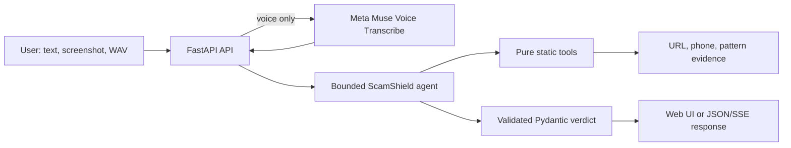

# ScamShield

ScamShield is a privacy-first scam-triage agent for everyday users in Bangladesh: paste an SMS, upload a screenshot, or add a WAV voice clip, and a Muse Spark agent investigates URLs, phone numbers, and Bangla/English scam signals before returning a clear verdict, risk score, evidence, and safe next steps.

## Architecture



The server never visits URLs found in messages. URL checks are static only. User text, images, and audio are held in memory for the request and are not written to application logs or project files.

## Run locally

```bash
python -m venv .venv
# macOS/Linux:
source .venv/bin/activate
# Windows PowerShell:
# .venv\Scripts\Activate.ps1
python -m pip install -r requirements.txt
cp .env.example .env
# Add MODEL_API_KEY to .env
python -m uvicorn app:app --reload
```

Open <http://127.0.0.1:8000>.

Docker:

```bash
docker compose up --build
```

## Environment variables

| Variable | Default | Purpose |
|---|---|---|
| `MODEL_API_KEY` | required | Meta Model API key |
| `META_BASE_URL` | `https://api.meta.ai/v1` | OpenAI-compatible API base |
| `MODEL_NAME` | `muse-spark-1.3` | Standard Muse Spark model; never use `-contributor` |
| `ASR_MODEL` | `muse-voice-transcribe-1.0` | Official Muse Voice Transcribe model |
| `MAX_AGENT_STEPS` | `6` | Agent loop guard |
| `API_TIMEOUT_SECONDS` | `25` | Per-call timeout |
| `API_RETRIES` | `2` | Retry count for 429/5xx/network timeout |
| `CORS_ORIGINS` | localhost origins | Comma-separated allowed browser origins |

## API

- `POST /api/analyze`: multipart `text` plus optional PNG/JPEG/WebP `image`; returns `result` and trace.
- `POST /api/analyze/stream`: same fields; returns Server-Sent Events for `tool_call`, `tool_result`, and `verdict`.
- `POST /api/analyze/voice`: multipart WAV `audio`; sends the documented `request` JSON plus audio to `POST /v1/asr/transcribe`, then analyzes the transcript.
- `GET /`: browser interface.

Voice input follows Meta's official Speech to Text documentation: mono 16-bit PCM WAV at 16 kHz or 24 kHz, `audioEncoding: "WAV"`, and `languageBias: ["Bengali", "English"]`. Unsupported formats are rejected instead of guessed or silently converted.

## Evaluation

`eval/eval_set.json` contains 30 fabricated Bangla and English examples (16 labelled scam, 14 labelled legit). Run:

```bash
python eval/run_eval.py
```

Measured deterministic pattern-baseline result on this fabricated set:

```text
examples=30
accuracy=0.8667
confusion_matrix=actual rows, predicted columns
             scam  legit
 scam          12      4
legit           0     14
```

This is not a real-world benchmark and should not be interpreted as one.

## Limitations and safety

- Tool checks are evidence, not proof. A legitimate domain can still host a compromised page, and a valid phone number can be abused.
- The model may be unavailable, rate-limited, or uncertain; the API returns a cautious fallback verdict rather than pretending certainty.
- Do not share PINs, passwords, OTPs, or full account details with anyone. Verify through the provider's official app or published hotline.
- Voice currently accepts supported WAV files only. Live microphone streaming is not included.

## What I built during the hackathon

- Reworked the starter into a typed FastAPI package while keeping `uvicorn app:app` compatibility.
- Added validated verdict schemas, bounded/retrying tool-calling, explicit fallback behavior, static Bangladesh-focused tools, and SSE investigation events.
- Added documented Meta Voice Transcribe integration for Bangla/English WAV input.
- Added bilingual, mobile-first UI, security limits, CI, Docker packaging, and a fabricated evaluation harness.

## Development

```bash
python -m pytest -q
python -m ruff check .
python -m mypy scamshield app.py tools.py eval/run_eval.py
python eval/run_eval.py
```

See [DEMO.md](DEMO.md) for the exact three-minute walkthrough.

Security and assurance artifacts:

- [THREAT_MODEL.md](THREAT_MODEL.md)
- [SECURITY_RISK_ASSESSMENT.md](SECURITY_RISK_ASSESSMENT.md)
- [QUALITY_PLAN.md](QUALITY_PLAN.md)
- [OPERATIONS.md](OPERATIONS.md)
- [SECURITY.md](SECURITY.md)
- [SECURITY_EVIDENCE.md](SECURITY_EVIDENCE.md)
