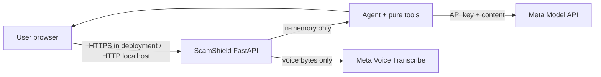

# ScamShield threat model

## Scope and data classification

ScamShield is a Tier 1 hackathon prototype. User messages, screenshots, and voice clips are **sensitive
personal data** while in transit and memory. The app does not intentionally persist them. The Meta API
receives the submitted content for inference/transcription, so users must not submit secrets or unnecessary
identity data.

## Data flow and trust boundaries

Trust boundaries:

1. Browser to server: untrusted text, files, headers, and request sizes.
2. Server to Meta: external service and third-party processing boundary.
3. Model output to application: untrusted structured text and tool arguments.

## STRIDE review

| Boundary | Threat | Mitigation | Residual risk |
|---|---|---|---|
| Browser → API | Spoofing / abuse | No account state; ephemeral IP rate limit | Rate limit is process-local |
| Browser → API | Tampering / injection | Pydantic verdict validation; bounded text and files; MIME allowlist | Model prompt injection remains possible |
| Browser → API | Information disclosure | No content logging or disk writes; `.env` ignored | Hosting/provider logs need separate controls |
| Browser → API | Denial of service | Request, media, text, step, timeout, and retry limits | No WAF or distributed limiter |
| API → Meta | Information disclosure | Explicit user-facing privacy boundary; API key from environment | Meta API retention and account settings apply |
| API → Meta | SSRF | URLs are parsed statically; server never fetches message URLs | External API itself is trusted by deployment |
| Model → API | Tampering / elevation | Strict verdict schema, one repair attempt, explicit tool errors, fallback | Model can still produce misleading evidence |
| API → Browser | XSS / framing | DOM text insertion, no user HTML rendering, `X-Frame-Options`, `nosniff` | Deployment must use TLS and a restrictive CSP |

## Security acceptance criteria

- No URL in user content is fetched by the application.
- User content is not written to application files or logs.
- Invalid verdicts cannot reach the user as a success-shaped report.
- Oversized or unsupported uploads are rejected before model calls.
- CI runs tests, Ruff, mypy, Bandit, dependency auditing, and secret scanning.
- Known limitations remain documented before demo or release.

## Open risks before production

- Add TLS termination, authentication where required, centralized rate limiting, CSP, monitoring, and a
  secrets manager.
- Run DAST against a staging deployment and an independent penetration test.
- Review Meta Model API data-retention settings and complete a privacy notice.
